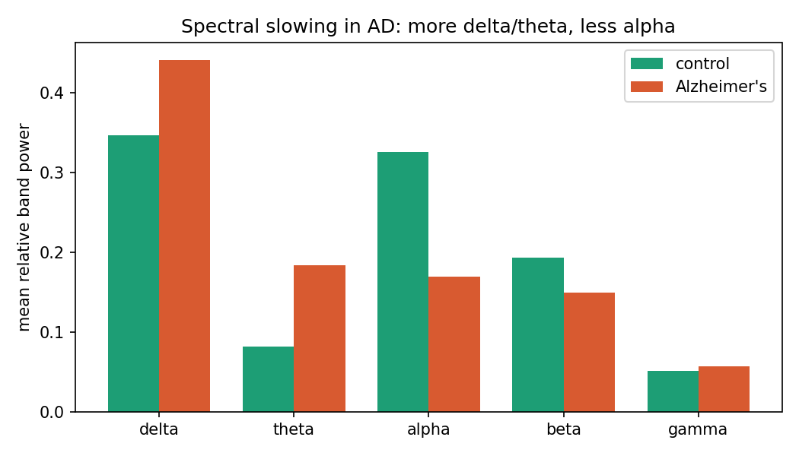
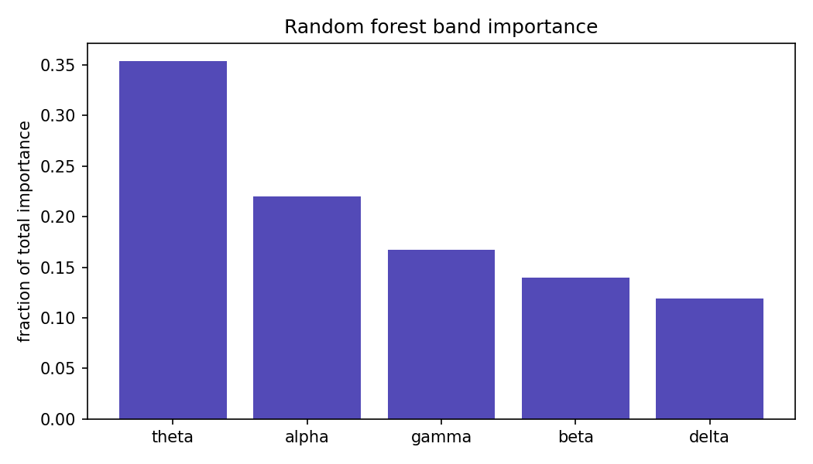

# EEG-based screening for Alzheimer's disease

A resting-state EEG classifier that distinguishes **Alzheimer's disease (AD)** from **healthy controls (HC)**, built on the public OpenNeuro **ds004504** dataset. The full pipeline — preprocessing, feature extraction, modelling, and interpretation — is implemented from scratch and validated with **subject-wise cross-validation** to avoid the data leakage that silently inflates many EEG machine-learning results.

The goal of this project was not to chase a high number, but to produce a *defensible* one: a result where every percentage point survives scrutiny.

## Headline result

|Metric|Score|
|-|-|
|**Balanced accuracy (AD vs HC)**|**0.78 ± 0.09**|
|Accuracy|0.74 ± 0.10|
|Majority-class reference|0.55|
|Validation|5-fold **subject-wise** GroupKFold|

Balanced accuracy is *higher* than raw accuracy, which indicates the model separates both classes rather than leaning on the larger one. An independent re-implementation on the same dataset reports comparable binary accuracy (\~0.75), and the dataset's authors validate with Leave-One-Subject-Out — the same subject-wise principle used here.

## Why subject-wise validation is the whole point

Each subject contributes \~200 four-second epochs that look highly similar to one another (same skull, same electrode placement, same individual rhythm). If epochs from one person are split across both the training and test sets, a model can score \~95% simply by *recognising the person* rather than the disease — a textbook case of data leakage.

`GroupKFold` keyed on subject ID guarantees that all of a subject's epochs stay on one side of every split. At test time the model therefore faces people it has never seen, which is the real screening task. This is the single most important methodological decision in the project, and it is the reason the reported accuracy is a believable 0.74 rather than a hollow 0.95.

## Dataset

**OpenNeuro ds004504** (Miltiadous et al., 2023), CC0 licence, BIDS format.

* 88 subjects: 36 Alzheimer's, 23 frontotemporal dementia, 29 healthy controls
* Eyes-closed resting-state EEG, 19 channels (10–20 system), 500 Hz
* \~13 minutes per recording on average (length varies by subject)
* Collected at AHEPA General University Hospital of Thessaloniki, Greece (50 Hz mains)

This project uses the **raw** recordings and performs its own preprocessing, rather than the dataset's provided cleaned derivatives. The binary AD-vs-HC task uses 65 subjects (36 AD, 29 HC); frontotemporal dementia is excluded (see limitations).

## Pipeline

**Preprocessing** (`preprocess\_all.py`)

* Band-pass filter 0.5–45 Hz; notch filter at 50 Hz (Greek mains)
* Average reference
* Segmentation into 4 s non-overlapping epochs (\~200 per subject)
* ICA (extended Infomax, 15 components) with automatic artifact rejection via **ICLabel** — components classified as non-brain with ≥ 0.80 confidence are removed
* Output: clean epoch files per subject

**Feature extraction** (`features.py`)

* For each channel, **relative band power**: the fraction of total 0.5–45 Hz power (Welch PSD) falling in each of five bands — delta (0.5–4), theta (4–8), alpha (8–12), beta (12–30), gamma (30–45 Hz)
* 5 bands × 19 channels = **95 features per epoch**
* Relative (rather than absolute) power is used because it is robust to inter-subject amplitude differences and captures the spectral *balance*, which is where the AD signature lives

**Modelling** (`model.py`)

* Random forest (300 trees)
* 5-fold subject-wise `GroupKFold`
* Majority-class and balanced-accuracy references reported alongside

*Note on the baseline:* a majority-class classifier scores \~0.55 on the pooled data. Under the same subject-wise folds, the dummy averages 0.41 because the class balance varies fold to fold — so 0.55 is the fair reference point for accuracy and 0.50 for balanced accuracy.

## Results and interpretation

The classifier was checked for whether it works *for the right reasons* (`interpret.py`).

### The disease is visible in the spectra



Comparing mean relative band power between groups reproduces the textbook **spectral slowing** of Alzheimer's: power drains out of the fast rhythms and pools in the slow ones.

|Band|Control|AD|AD − control|
|-|-|-|-|
|delta|0.347|0.441|**+0.094**|
|theta|0.082|0.184|**+0.102**|
|alpha|0.326|0.169|**−0.157**|
|beta|0.194|0.149|−0.045|
|gamma|0.051|0.057|+0.006|

The two largest effects — the alpha collapse and the theta surge — are exactly those emphasised in the clinical literature.

### The model relies on the right bands



The forest's two most important bands are **theta (35%)** and **alpha (22%)** — precisely the two bands with the largest group differences. The model's decisions are driven by genuine disease physiology, not an incidental artifact.

Two honest nuances:

* **Delta** shows a real group difference but low model importance. Because the five relative powers are compositional (they sum to \~1), theta and delta partly encode the same "slowing," so the forest's importance concentrates on theta. Feature importance is not the same as effect size — both views are reported so they can be cross-checked.
* **Gamma** receives notable importance (\~17%) despite no group-level difference. Gamma is the band most prone to muscle and line-noise contamination, so some of that weight may reflect residual artifact rather than physiology — a candidate for an ablation experiment.

## Honest limitations

* **Epoch-level scoring.** Accuracy is computed per 4-second epoch. A subject-level prediction (majority vote across a subject's epochs) is the clinically meaningful unit and is not yet implemented.
* **Binary task only.** Frontotemporal dementia is excluded. FTD is difficult to separate from resting EEG (the dataset's own paper reports poor FTD detection), and three-class classification was not attempted.
* **ICLabel out of range.** ICLabel is trained on 1–100 Hz data; here the signal is filtered to 0.5–45 Hz, so its component classification operates slightly outside its intended range. Eye-artifact detection remained reliable, but this is a known caveat.
* **Gamma caveat.** See above — part of the gamma importance may be artifact-driven.
* **Simple feature set.** Relative band power only — no functional connectivity, nonlinear/complexity measures, or richer spatial features, all of which could improve performance and specificity.
* **Single site, single dataset.** All recordings come from one hospital and one EEG system. There is no external-cohort validation, so cross-site generalisation is untested.
* **Modest sample.** 65 subjects in the binary task; the ±0.09 fold-to-fold variance reflects this.
* **Not a diagnostic tool.** This is a research demonstration, not a clinically validated instrument.

## Reproduce

```bash
# 1. Environment
python -m venv .venv \&\& . .venv/Scripts/activate   # Windows
pip install -r requirements.txt

# 2. Data (excluded from the repo via .gitignore)
openneuro-py download --dataset ds004504 --target-dir data/ds004504

# 3. Run the pipeline in order
python preprocess\_all.py     # raw -> clean epochs  (data/clean/)
python features.py           # clean epochs -> features.npz
python model.py              # random forest + subject-wise CV
python interpret.py          # spectral comparison + band importances
python figures.py            # writes figures/\*.png
```

### Repository layout

```
explore.py            Inspect the BIDS dataset (sampling rate, channels, PSD)
preprocess\_all.py     Full preprocessing across all subjects
features.py           Relative band-power feature extraction
model.py              Classification with subject-wise validation
interpret.py          Interpretability checks
figures.py            Figure generation
figures/              Result figures (committed)
data/                 Dataset and intermediates (gitignored)
```

## References

Miltiadous, A., Tzimourta, K. D., Afrantou, T., Ioannidis, P., Grigoriadis, N., Tsalikakis, D. G., Angelidis, P., Tsipouras, M. G., Glavas, E., Giannakeas, N., \& Tzallas, A. T. (2023). *A Dataset of Scalp EEG Recordings of Alzheimer's Disease, Frontotemporal Dementia and Healthy Subjects from Routine EEG.* Data, 8(6), 95. https://doi.org/10.3390/data8060095

Dataset: https://openneuro.org/datasets/ds004504 (CC0)

\---

*Built with Python, MNE-Python, and scikit-learn. Part of a portfolio exploring bioelectric signals from mechanism to measurement.*

